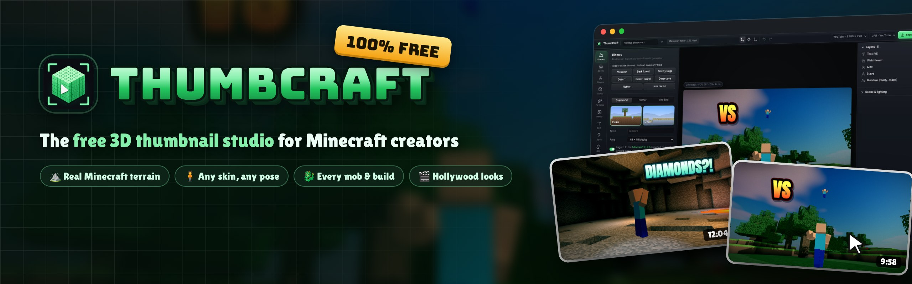
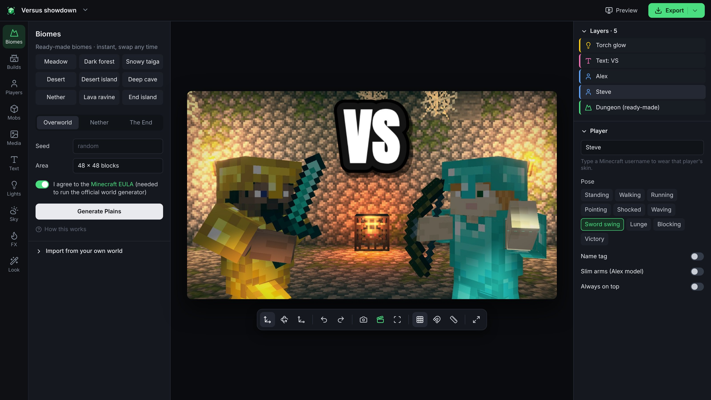
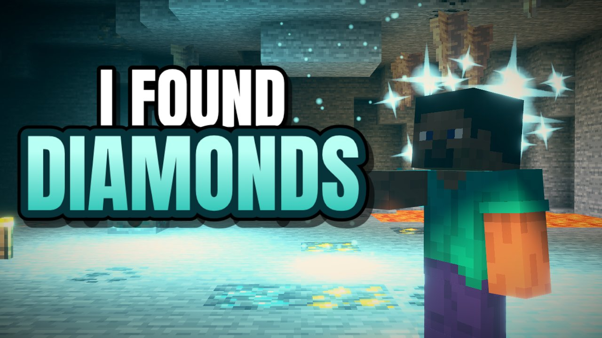
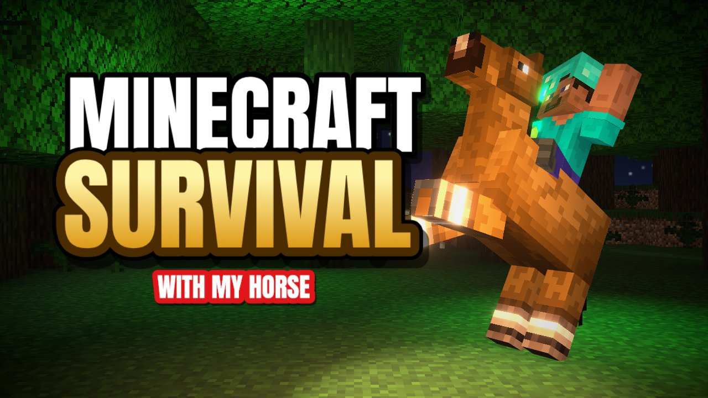
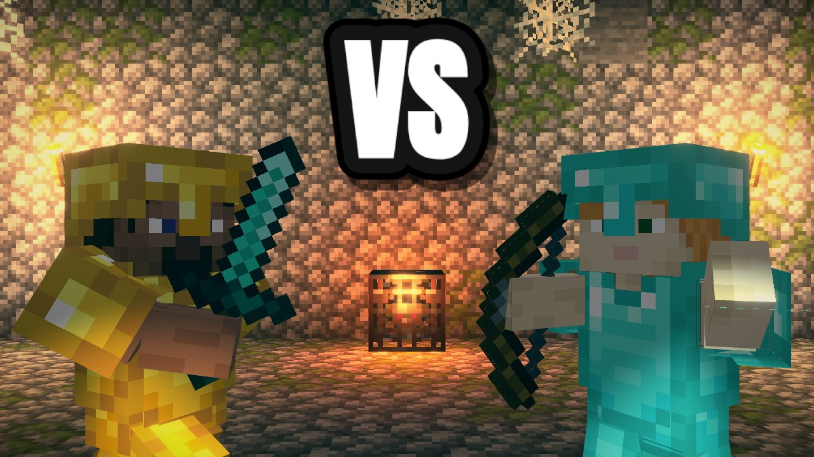
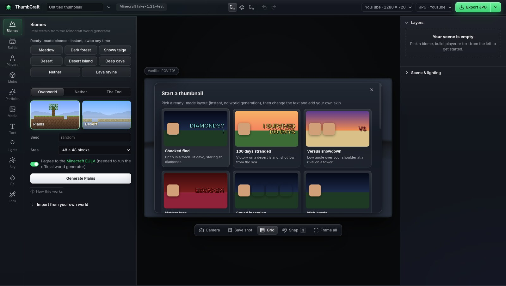
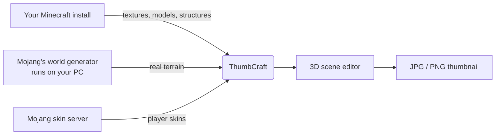

<div align="center">



# ThumbCraft

Build a 3D scene from real Minecraft terrain, drop in your skin and your mobs, add big bold text and export a
YouTube-ready thumbnail in minutes. No Photoshop and no render farm needed.

[](https://github.com/Loveguard/ThumbCraft/releases/latest)


[](LICENSE)



</div>

## What is it?

ThumbCraft is a desktop app that turns your own copy of Minecraft into a thumbnail studio.

- **It looks like the real game, because it is the real game.** Terrain comes from Mojang's own world generator.
  Blocks, mobs and textures are read from the Minecraft version you play.
- **It's built for thumbnails.** You get outlined title text, dramatic lighting, posable players, smoke, fire and
  explosions. Exports come out at exactly YouTube's size and stay under its 2 MB limit.
- **It's quick.** Pick a ready-made scene, type your username, change the text and export.

<table>
  <tr>
    <td></td>
    <td></td>
    <td></td>
  </tr>
  <tr>
    <td align="center"><sub>Shocked find</sub></td>
    <td align="center"><sub>100 days stranded</sub></td>
    <td align="center"><sub>Versus showdown</sub></td>
  </tr>
</table>

## Features

| Feature                 | What you get                                                                                                                                                                                                                                                                                                                                                                         |
| ----------------------- | ------------------------------------------------------------------------------------------------------------------------------------------------------------------------------------------------------------------------------------------------------------------------------------------------------------------------------------------------------------------------------------ |
| 🌍 **Real terrain**     | Any biome in the Overworld, Nether or End, generated by Minecraft itself. Cut an area out of your own singleplayer worlds. Instant ready-made backdrops (meadow, dark forest, desert island, deep cave, lava ravine…).                                                                                                                                                               |
| 🧍 **Players**          | Type any username to get that skin, including slim arms and the outer layer. Posable down to elbows and knees, with action poses (attack, lunge, run, shocked…), armor and held items.                                                                                                                                                                                               |
| 🐉 **Mobs**             | Every mob and entity model in your game version, with texture variants and per-limb posing.                                                                                                                                                                                                                                                                                          |
| 🏠 **Builds**           | Every vanilla structure, from village houses to bastions and ancient cities, with isometric previews. You can also import `.schem`, `.litematic` and `.nbt` files.                                                                                                                                                                                                                   |
| 🔥 **FX**               | Smoke, fog, fire, explosions, embers, magic, light beams, lightning strikes, **shine** (star glints that make loot and diamonds sparkle), rain and snow, plus particles straight from the game.                                                                                                                                                                                      |
| 💡 **Lighting & looks** | Four render modes: Vanilla, Cinematic, Soft and Cartoon (the bright cel-shaded style of Minecraft's key art). Coloured lights, bloom, god rays and a movable sun. Film-style colour looks built as real 3D LUTs, plus your own `.cube` LUTs from DaVinci Resolve or Premiere.                                                                                                        |
| 🎯 **Focus & lens**     | Drag a focus point onto anything and it stays sharp while the rest blurs; add more points for several subjects. Lens warp (curved-TV bulge or pinch, never black corners), speed burst, anamorphic streaks, chromatic aberration, vignette, film grain and a CRT TV look.                                                                                                            |
| 🔤 **Text & media**     | Thumbnail-style outlined text with gradients and glow, 3D text in the Minecraft font, carved **stone titles** in any colour and front-on **Hardcore titles** (every O becomes the hardcore heart). Your own images, videos and 3D models, and one-click background removal. Anything can be set **always on top** with **flat lighting**, so a title never disappears behind a tree. |
| 🗂️ **Tabs**             | Several projects open at once, one tab each. **Duplicate as new tab** makes a variant to try something without touching the original; put two tabs side by side as a **split image** ("Day 1 vs Day 100") with a straight, torn-paper or lightning divider.                                                                                                                          |
| 🏷️ **Thumbnail kit**    | Bold arrows, circles, crosses, ticks, bursts and boxes in any colour, with outline and glow. Line thickness is adjustable, and so are an arrow's tail length and a circle's or box's width.                                                                                                                                                                                          |
| 📺 **YouTube preview**  | See your thumbnail (and every other open tab) in a mock home feed, search results, the "up next" list and on a phone, in dark or light mode, before you upload.                                                                                                                                                                                                                      |
| 📤 **Export**           | JPG or PNG at 1280×720, 1080p, 4K or Shorts size, or several at once. What you see in the viewport is exactly what you export.                                                                                                                                                                                                                                                       |
| 💾 **Projects**         | Save and reopen scenes, with autosave and crash recovery. Projects carry everything they need, so they open the same on any PC.                                                                                                                                                                                                                                                      |

[Full feature reference →](docs/FEATURES.md)

## Install

1. Download the latest version from the **[Releases page](https://github.com/Loveguard/ThumbCraft/releases/latest)**:
   - **Windows:** `ThumbCraft-Setup-<version>.exe` installs the app and keeps it up to date.
     `ThumbCraft-<version>-portable.exe` runs without installing.
   - **macOS:** the `.dmg` works on Intel and Apple Silicon.
2. Open it.
   - **Windows:** the app isn't code-signed yet, so SmartScreen may say _"Windows protected your PC"_. Click
     **More info → Run anyway**. (How to turn signing on: [docs/SIGNING.md](docs/SIGNING.md).)
   - **macOS:** see [Installing on a Mac](#installing-on-a-mac) below. It takes one extra step the first time.
3. That's it. ThumbCraft finds your Minecraft automatically, whether it's the official launcher, Prism, Modrinth
   or CurseForge.

### Installing on a Mac

ThumbCraft is free and made by one creator. Apple only "notarises" apps for members of its developer program,
which costs $99 a year, so the Mac version isn't notarised. It works fine, but macOS blocks it on first launch
with _"ThumbCraft can't be opened because Apple cannot check it for malicious software"_. You only need to
allow it once:

1. Open the `.dmg` and drag **ThumbCraft** into **Applications**.
2. Open ThumbCraft. When macOS blocks it, click **Done** (or **OK**).
3. Open **System Settings → Privacy & Security**, scroll down to _"ThumbCraft was blocked…"_ and click
   **Open Anyway**. Confirm with your password or Touch ID.

On macOS 14 (Sonoma) and older you can instead **right-click the app → Open → Open**.

If macOS says the app _"is damaged and can't be opened"_, that's the same block worded differently. Paste this
into **Terminal** and open the app again:

```bash
xattr -dr com.apple.quarantine /Applications/ThumbCraft.app
```

On a Mac, new versions are announced inside the app with a download link; they don't install themselves.

**You need** Minecraft: Java Edition 1.18 or newer. If the app can't find your game, it downloads the files
from Mojang for you. Generating terrain needs Java. The official launcher already includes it, and if it's
missing ThumbCraft installs it with one click.

## System requirements

ThumbCraft is light. If your PC can run Minecraft, it can run ThumbCraft, and most 10-year-old laptops can too.

|                | Minimum (it runs)                                                    | Recommended (smooth)                               |
| -------------- | -------------------------------------------------------------------- | -------------------------------------------------- |
| **System**     | Windows 10 (64-bit) · macOS 12 Monterey                              | Windows 11 · any recent macOS                      |
| **Processor**  | Any 64-bit dual-core (Intel Core i3 4th gen / AMD A8, ~2013)         | Quad-core (Intel Core i5 / Ryzen 3 or newer)       |
| **Memory**     | 4 GB RAM                                                             | 8 GB RAM                                           |
| **Graphics**   | Any GPU with WebGL 2, including built-in ones (Intel HD 4000, ~2012) | Any dedicated GPU or Intel Iris Xe / Apple Silicon |
| **Disk space** | 1 GB free                                                            | 2 GB free                                          |
| **Internet**   | Only the first time (game files, Java) and to fetch player skins     | Same                                               |

- **On an older or slower PC,** use the **Vanilla** render mode: it's the lightest, and drawing the scene the
  way the game does costs very little. Cinematic, Soft and Cartoon add real-time shadows and effects that a
  modern GPU handles easily.
- **Generating terrain** runs Minecraft's own server in the background, so it is the one step that likes more
  memory: ThumbCraft gives it a quarter of your RAM (1 GB on a 4 GB PC), and it simply takes a little longer on
  older machines. The ready-made backdrops need nothing extra.
- **Exports** (even 4K) are rendered once when you click Export, so a slow PC just takes a second longer.

## Your first thumbnail



1. **Pick a scene** on the start screen, or start empty and choose a biome.
2. **Make it yours.** Click the player and type your username. Click the text and change it.
3. **Frame it.** Drag to orbit, right-drag to pan, scroll to zoom. Hold **Shift** while moving things to snap
   them onto surfaces.
4. **Add drama** from the **FX**, **Lights** and **Look** tabs.
5. **Export.** The file is ready to upload to YouTube; the arrow next to Export picks the size and file type.

## How to use it

The labelled icons on the left open one panel at a time (click the open one again to fold the panel away),
and the panel on the right edits whatever you've selected. Every editing tool (move, rotate, scale, undo, camera
angles, saved view, frame all, grid, snap, rulers) sits in the dock under the canvas. **Hide panels** (the last dock
button, or **\\**) clears both side panels away so the thumbnail fills the window.

- **Biomes:** swap in a ready-made backdrop instantly, or generate any real biome (needs Java; the first run
  takes up to a minute). **Import from your own world** cuts an area out of one of your saves.
- **Builds** and **Mobs:** sorted into colour-coded sections you can fold open. Click a tile to place it in
  front of the camera; use the arrows on a build to flip through its variants. Search looks everywhere.
- **Players:** type a username to fetch the skin. Pick a pose, then fine-tune any joint: click a limb of the
  selected player for rotate handles, or drag a value in the properties panel.
- **Text:** title text for the classic thumbnail look, 3D Minecraft-font text, carved **stone titles** in any
  colour, or front-on **Hardcore titles** (every O turns into the hardcore heart; `<3` works too).
- **Look:** colour-coded sections for the colour look (LUT), manual adjustments, focus, lens, overlays, and
  light & sun. **Keep titles clean** (on by default) keeps blur, grain and lens effects off your titles.
- **Focus:** turn on focus blur and a focus point appears over the viewport. Drag it onto your subject; the **+**
  on its edge adds another point.
- **Always on top & flat lighting:** any object (a title, a player, a build) can be set to draw over everything
  and to ignore the scene's lights, so it's never hidden by a tree or half in shadow.
- **Tabs:** New project and Open use a new tab, so several projects stay open; **Duplicate as new tab** (project
  menu or the tab bar) copies this one to try a variant. **Ctrl+Tab** switches, middle-click closes.
- **Arrows & shapes** (Text panel): stickers that sit flat on the thumbnail. Drag to move, the corner handle to
  resize, the top handle to turn and the side handle to stretch (an arrow's tail, a circle's width). Thickness is in
  the properties panel.
- **Split image** (tab bar, once two projects are open): two tabs side by side with a straight, torn-paper or
  lightning divider. Lean and position are adjustable.
- **YouTube preview** (**Preview** in the top bar): your thumbnail and other open tabs in the home feed, search, "up next" and on a
  phone. The video length sits in the bottom-right corner, so keep faces and text clear of it.
- **Render mode** (Render & camera, right panel): Vanilla is exactly the game's look; Cinematic, Soft and
  Cartoon add a real sun with shadows.

### Shortcuts

| Keys                          | Does                                      |
| ----------------------------- | ----------------------------------------- |
| **W / E / R**                 | Move / rotate / scale the selection       |
| **Shift** (while moving)      | Snap to surfaces and corners              |
| **Ctrl+click / Shift+click**  | Add to the selection (viewport or Layers) |
| **Shift+drag** on empty space | Box-select everything inside              |
| **Ctrl+A**                    | Select everything except the ground       |
| **Ctrl+G / Ctrl+Shift+G**     | Group / ungroup the selection             |
| **Shift+R**                   | Rulers and centre guides                  |
| **\\**                        | Hide / show the side panels               |
| **Ctrl+Z / Ctrl+Y**           | Undo / redo (camera moves included)       |
| **Ctrl+D**                    | Duplicate the selection                   |
| **Delete**                    | Remove the selection                      |
| **C**                         | Save the view / jump back to it           |
| **Ctrl+T / Ctrl+Tab**         | New tab / next tab                        |
| **Esc**                       | Deselect                                  |
| **Ctrl+N / Ctrl+O / Ctrl+S**  | New / open / save project                 |

_Psst: there's a secret code somewhere. Find it, and three extra scenes unlock._

## How it works



ThumbCraft never ships any Minecraft files. Everything game-related comes from your own installation or
straight from Mojang's servers to your PC. Under the hood it resolves block models exactly as the game does,
runs the official server headless to generate terrain, and bakes mob models with the game's own code. The
details are in [docs/DEVELOPMENT.md](docs/DEVELOPMENT.md#how-it-stays-accurate-nothing-is-guessed).

## Privacy & safety

- **No accounts, no tracking, no telemetry.** Nothing about you or your projects is uploaded anywhere.
- **The app talks only to these servers:**
  - Mojang: game files, and skins for the usernames you type.
  - Adoptium: Java, only if you ask it to install Java.
  - GitHub: update checks.
- **Every downloaded program is verified.** Game files are checked against Mojang's SHA-1 hashes, and Java against
  Adoptium's SHA-256, before anything runs.
- **Opening a project is safe.** The app runs in Electron's sandbox, can't open web pages inside itself, and
  ignores project files that try to load files from your disk.

Found a security problem? Please report it privately through
[GitHub's security advisories](https://github.com/Loveguard/ThumbCraft/security/advisories/new) instead of a public
issue.

## FAQ

<details>
<summary><b>Is it free?</b></summary>

Yes, completely, and it's open source under the MIT licence.

</details>

<details>
<summary><b>Does it work with my Minecraft version?</b></summary>

ThumbCraft supports Java Edition 1.18 through the latest release, including the new 26.x versions. It always
uses the newest version you have installed. Bedrock Edition isn't supported.

</details>

<details>
<summary><b>Generating a biome is slow the first time. Is that normal?</b></summary>

Yes. The first generation downloads and starts Mojang's server, which takes up to a minute or so. After that it
stays warm and new areas take seconds. The ready-made backdrops are always instant.

</details>

<details>
<summary><b>Can I monetise thumbnails I make with it?</b></summary>

Mojang's [usage guidelines](https://www.minecraft.net/usage-guidelines) allow screenshots and videos, including
monetised ones. Thumbnails are covered.

</details>

<details>
<summary><b>Is it safe to click "Open Anyway" on a Mac?</b></summary>

The warning only means the app hasn't gone through Apple's paid notarisation, not that anything bad was found. The
full source code is in this repository, and every release is built from it by GitHub Actions, where anyone can
see the build logs.

</details>

<details>
<summary><b>A mob or block looks wrong.</b></summary>

Please [open an issue](https://github.com/Loveguard/ThumbCraft/issues/new) with a screenshot and your Minecraft
version. The Mobs tab has a **Copy details** button for errors, and it removes your username from file paths.

</details>

## Build from source

```bash
git clone https://github.com/Loveguard/ThumbCraft.git
cd ThumbCraft
npm install
npm run dev
```

You'll need Node.js 22. The project layout, tests, releasing and roadmap are in
[docs/DEVELOPMENT.md](docs/DEVELOPMENT.md). Contributions are welcome: open an issue first for anything big.

## Licence

ThumbCraft is released under the [MIT licence](LICENSE). Bundled fonts, libraries and the background-removal
model keep their own licences; see [THIRD_PARTY_NOTICES.md](THIRD_PARTY_NOTICES.md) and
[docs/LEGAL.md](docs/LEGAL.md).

<sub>NOT AN OFFICIAL MINECRAFT PRODUCT. NOT APPROVED BY OR ASSOCIATED WITH MOJANG OR MICROSOFT. Minecraft is a
trademark of Mojang Studios.</sub>
